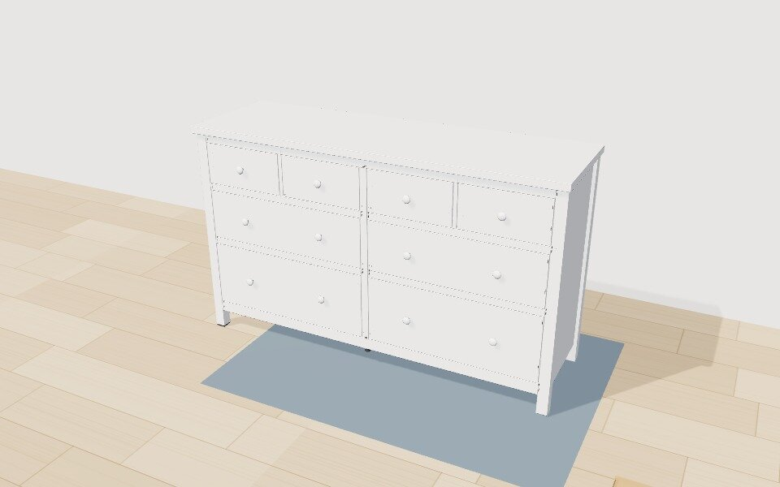
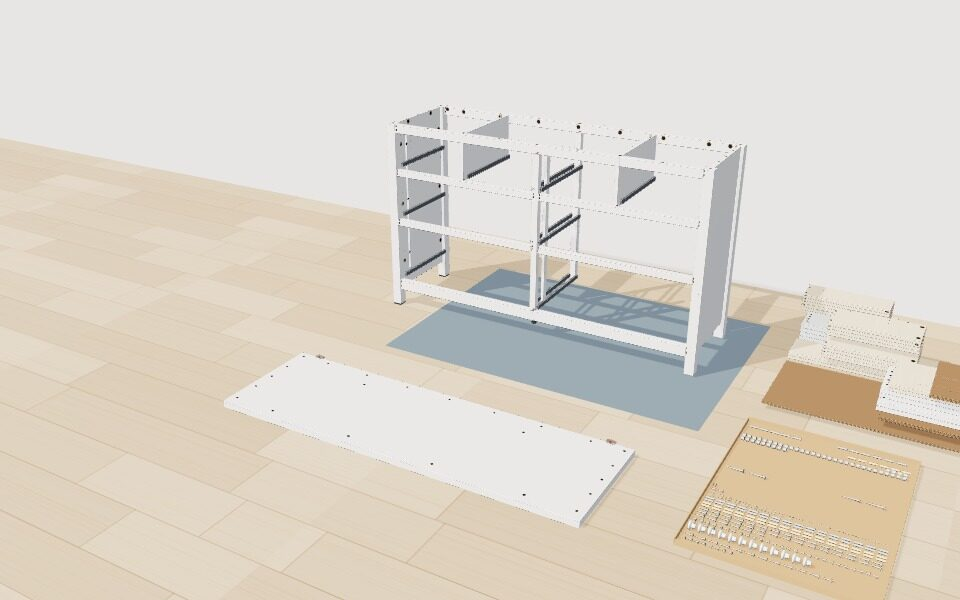

# Kaputle

Interactive 3D assembly guides, built from paper manuals. Every step follows the manual's order, every
screw and dowel shows the part number printed in the bag, and you can turn the build around, slow
it down or tap any part to see what it is and where it goes.

**[Try the 8-drawer dresser](https://dharshanvk-code.github.io/kaputle/guide/?product=hemnes)** ·
[Console table](https://dharshanvk-code.github.io/kaputle/guide/?product=console) ·
[About the project](https://dharshanvk-code.github.io/)



## Guides

| Product | From | Parts | Steps |
|---|---|---|---|
| [8-drawer dresser](https://dharshanvk-code.github.io/kaputle/guide/?product=hemnes) | 52-page IKEA HEMNES manual | 497 | 95 |
| [Console table](https://dharshanvk-code.github.io/kaputle/guide/?product=console) | 8-page IKEA LACK manual | 40 | 11 |
| [Bookshelf](https://dharshanvk-code.github.io/kaputle/guide/?product=bookshelf) | A hand-written example | 32 | 10 |

## How it works

Nothing is hand-animated. The player in [`guide/`](guide) reads one product file that lists every
part (its shape, size, material and position in the finished product) and every step in order. From
that alone it builds the 3D parts, lays out the box contents, works out where the pre-drilled holes
are, and animates each step.



It can follow what real manuals do:

- **Build in any orientation:** start upside down or on its side, and turn the whole build over or
  stand it up with `flip` steps.
- **Work on the floor first:** fit hardware to a part before it goes in (`parent`), nested as deep
  as needed, such as a drawer side with its dowels fitted to a drawer front. The player sets those
  pieces out in front of the build, the right face up, and `turn` steps turn them over.
- **Lower one piece onto another:** `lower` lifts the build and sets it down onto a part.
- **Embed it in another page:** `?embed` shows just the 3D view with a "Watch it build" button.

### The product file

```json
{
  "name": "Console table",
  "spec": "Black-brown · built from an 8-page paper manual · sizes estimated",
  "startFlipped": "x",
  "parts": [
    {"id": "top", "name": "Tabletop", "label": "", "shape": "board", "size": [140, 5, 35], "pos": [0, 72.8, 0], "material": "blackbrown"},
    {"id": "studL1", "name": "Cam stud", "label": "114928", "shape": "screw", "radius": 0.3, "length": 4, "pos": [-67.5, 67.8, -6], "dir": [0, 1, 0], "material": "steel", "parent": "top"}
  ],
  "steps": [
    {"manual": 2, "title": "Screw the cam studs into the tabletop", "text": "Screw the four cam studs into the holes near each end of the tabletop, with the tabletop lying flat.", "tool": "Screwdriver", "parts": ["studL1", "studL2", "studR1", "studR2"], "spin": 3}
  ]
}
```

An excerpt from [`console.json`](guide/products/console.json). Positions are in centimetres in the
finished, upright product (x left to right, y up, z towards the front). [`tools/validate-product.mjs`](tools/validate-product.mjs) documents every field by
checking it.

## Turning a manual into a guide

[`tools/manual-to-guide.mjs`](tools/manual-to-guide.mjs) sends a manual PDF to Claude, which drafts
the product file. The draft is checked against the format, and any problems go back to Claude to fix.

```sh
export ANTHROPIC_API_KEY=...
npm run manual -- ~/Downloads/manual.pdf --name "Nightstand"
```

It lists everything it had to estimate (manuals rarely give measurements), so you know what to check.
The dresser is big enough that its file is written by a script instead:
[`tools/products/hemnes.mjs`](tools/products/hemnes.mjs).

## Development

Needs Node 20 or later. It's a static site with no build step: three.js loads from a CDN.

```sh
npm install
npm start          # serves the guide at http://localhost:8000/guide/
npm test           # checks every product file, then plays every guide in a headless browser
npm run lint
```

The tests play every step of every guide forward and back, and check that nothing passes through
the floor, that every part ends exactly where its product file says, and that undoing every step
puts everything back in the box.

| Script | What it does |
|---|---|
| `npm run manual -- <pdf>` | Drafts a product file from a manual PDF |
| `npm run build:hemnes` | Rewrites the dresser's product file |
| `npm run record -- <product>` | Records a time-lapse video of a guide building itself (needs ffmpeg) |

## Project layout

```
guide/
  index.html, guide.css   the page
  products/               one JSON file per product
  src/
    main.js               loads a product and starts the player
    state.js              the shared state: parts, current step, what's set out on the floor
    assembly.js           moving parts: setting out, fitting, flipping, turning
    steps.js              next, back, jump, replay, play all
    camera.js             framing each step
    ui.js                 the step card, step list and labels
    info.js, diagram.js   the tap-a-part card and its picture
    parts.js, holes.js    building a part's model and its drilled holes
    pile.js               laying out the box contents
    scene.js, tween.js    the 3D view, and the animation clock
tools/                    the manual tool, validator, formatter, recorder and local server
tests/                    end-to-end tests
```

Not affiliated with IKEA. The manuals are IKEA's; the 3D models and guides are original, with sizes
estimated from the drawings.
