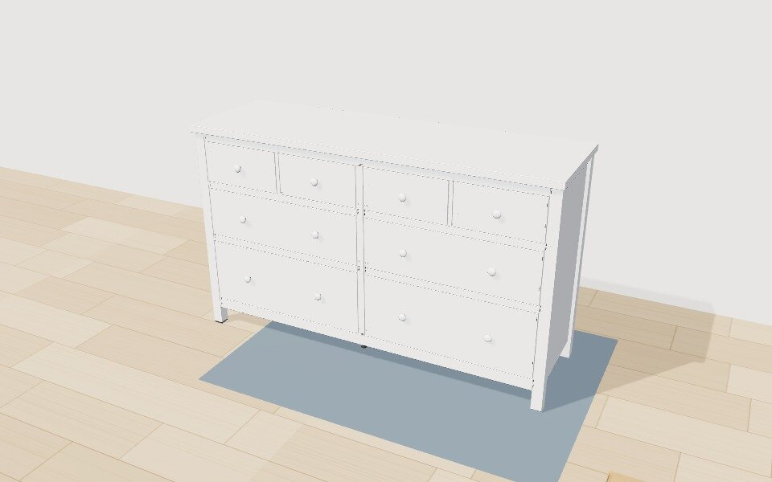
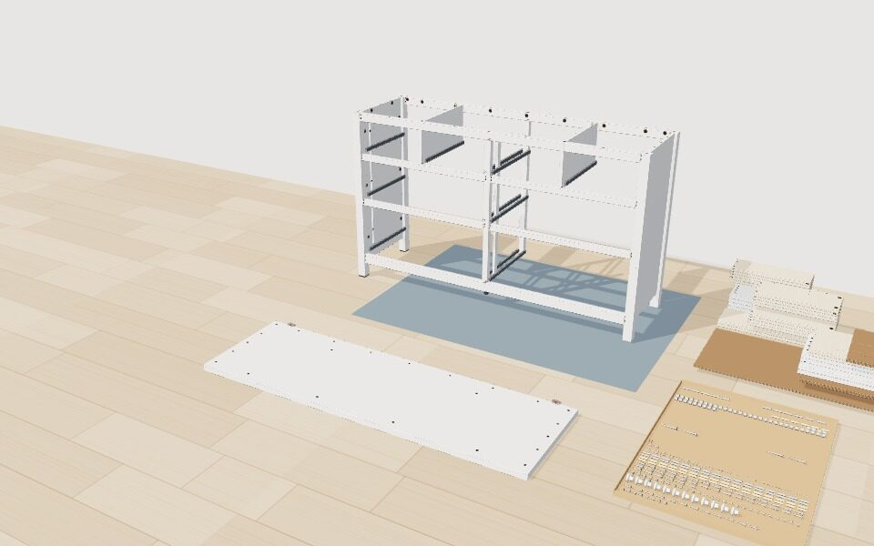

# Kaputle

Paper assembly manuals, rebuilt as 3D guides you can actually follow.

Each guide goes through the manual step by step, in the same order, with the same part numbers
that are printed on the bags in the box. You can spin the build around, replay a step slowly, or
tap any part to see what it is and where it goes.

**[Try the 8-drawer dresser](https://dharshanvk-code.github.io/kaputle/guide/?product=hemnes)** ·
[All guides](https://dharshanvk-code.github.io/kaputle/guide/library.html) ·
[About the project](https://dharshanvk-code.github.io/)



## Guides

| Guide | Built from | Parts | Steps |
|---|---|---|---|
| [8-drawer dresser](https://dharshanvk-code.github.io/kaputle/guide/?product=hemnes) | 52-page IKEA HEMNES manual | 497 | 95 |
| [2-drawer chest](https://dharshanvk-code.github.io/kaputle/guide/?product=hemnes-2-drawer) | 32-page IKEA HEMNES manual | 185 | 42 |
| [Console table](https://dharshanvk-code.github.io/kaputle/guide/?product=console) | 8-page IKEA LACK manual | 40 | 11 |
| [End table](https://dharshanvk-code.github.io/kaputle/guide/?product=end-table) | 2-page Furinno manual | 30 | 10 |
| [Bookshelf](https://dharshanvk-code.github.io/kaputle/guide/?product=bookshelf) | A small example I wrote by hand | 32 | 10 |

The 2-drawer chest and the end table were made by the manual tool (below) and published exactly
as it wrote them.

On a phone you can add Kaputle to your home screen. It then opens like an app, and any guide
you've opened once keeps working without internet.

## How it works

Nothing is animated by hand. Each guide is a single JSON file that lists every part (its shape,
size, material and where it sits in the finished piece) and every step in order. The player in
[`guide/`](guide) builds the 3D parts from that file, lays out the box contents, works out where
the pre-drilled holes go, and animates each step.



Real manuals do awkward things, so the player handles those too: building upside down or on its
side and flipping it over halfway, fitting hardware to a panel on the floor before it goes in,
and lowering a half-built frame onto a part. Here's a piece of the console table's file:

```json
{
  "name": "Console table",
  "startFlipped": "x",
  "parts": [
    {"id": "top", "name": "Tabletop", "shape": "board", "size": [140, 5, 35], "pos": [0, 72.8, 0], "material": "blackbrown"},
    {"id": "studL1", "name": "Cam stud", "label": "114928", "shape": "screw", "radius": 0.3, "length": 4, "pos": [-67.5, 67.8, -6], "dir": [0, 1, 0], "material": "steel", "parent": "top"}
  ],
  "steps": [
    {"manual": 2, "title": "Screw the cam studs into the tabletop", "text": "Screw the four cam studs into the holes near each end of the tabletop.", "tool": "Screwdriver", "parts": ["studL1", "studL2", "studR1", "studR2"], "spin": 3}
  ]
}
```

Sizes are in centimetres, measured in the finished piece standing upright. Every field is
described by the checks in [`tools/validate-product.mjs`](tools/validate-product.mjs).

## Turning a manual into a guide

Writing these files by hand takes a long time, so [`tools/manual-to-guide.mjs`](tools/manual-to-guide.mjs)
does it from the PDF. It sends the manual to Claude, checks the draft it gets back, and sends any
problems back to be fixed.

```sh
export ANTHROPIC_API_KEY=...
npm run manual -- ~/Downloads/manual.pdf --name "Nightstand"
```

The checks catch the mistakes that matter most: a part count that doesn't match the parts list
printed in the manual, a part floating in mid-air, or a screw poking out through the wood. When
it's done, the tool tells you how long it took, what it cost, and which sizes it had to guess.
`--effort` (`low` to `max`, default `high`) trades speed for care.

The dresser is too big to draft in one go, so its file is written by a script instead:
[`tools/products/hemnes.mjs`](tools/products/hemnes.mjs).

## User study

[`study.html`](https://dharshanvk-code.github.io/kaputle/guide/study.html) is for testing whether
the guides actually help. One group builds with the paper manual and another with the 3D guide.
Both are timed, can tap "Got stuck", and answer the same questions afterwards about how much they
enjoyed it and how confident they felt, while the facilitator notes mistakes and whether it was
built right. Results stay on the device and can be downloaded as a spreadsheet.

## Running it locally

You need Node 20 or later. There's no build step; three.js loads from a CDN.

```sh
npm install
npm start          # http://localhost:8000/guide/
npm test           # checks every guide file, then plays every guide in a headless browser
npm run lint
```

The tests play every guide forwards and backwards and make sure nothing goes through the floor,
every part ends up exactly where its file says, and undoing everything puts it all back in the box.

Other scripts:

- `npm run build:library` updates the list of guides and their pictures. Run it after adding a guide.
- `npm run build:hemnes` rewrites the dresser's file.
- `npm run record -- <guide>` records a time-lapse video of a guide building itself (needs ffmpeg).

## What's where

```
guide/          the site: the guide page, the list of guides, the study page, and offline support
  products/     one JSON file per guide, plus index.json, the list
  src/          the player, split by job (3D scene, parts, steps, camera, step card and so on)
tools/          the manual tool, the checks, and helper scripts
tests/          browser tests
docs/           pictures for this README
```

Not affiliated with IKEA or Furinno. The manuals are theirs; the 3D models and guides are
original, with sizes estimated from the drawings.

© 2026 Dharshan Vetrivelan. All rights reserved.
